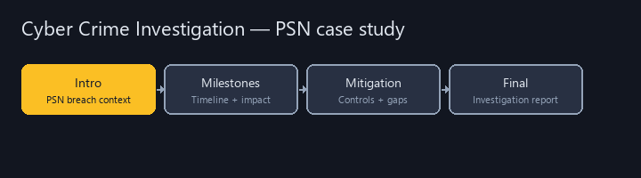
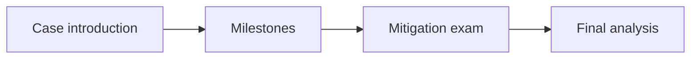

# Cyber Crime Investigation



College coursework portfolio for **Cyber Crime Investigation** at Eastern Michigan University.  
Milestone papers and a final assignment centered on the **2011 PlayStation Network breach** — timeline, impact, investigative angles, and mitigation.

**Author:** [Julio Barros](https://github.com/Jkbarros)  
**Index:** [college-projects](https://github.com/Jkbarros/college-projects)

## What is in this repository

| Area | Description |
|------|-------------|
| [Submissions catalog](docs/submissions-catalog.md) | All DOCX/PDF exports as markdown |
| [Introduction — PSN breach](docs/introduction-playstation-network-breach.md) | Case introduction |
| [Milestone two](docs/milestone-two.md) · [Milestone three](docs/milestone-three.md) | Progressive research milestones |
| [Mitigation examination](docs/examination-event-mitigation.md) | Event analysis and control gaps (PDF) |
| [Final assignment](docs/final-assignment.md) | Capstone write-up |
| [Archive index](docs/archive-index.md) | Original Canvas files |

### Highlights

- End-to-end **cyber crime case study** on a major public breach
- Readable markdown on GitHub plus originals under `archive/`

## Topics covered



## Regenerate docs

```bash
pip install -r requirements.txt
python scripts/docx_to_markdown.py
python scripts/build_pdf_docs.py
python scripts/generate_readme_demo.py
```

## Related repos

| Course | Link |
|--------|------|
| IA 447 - Digital Forensics I | [ia447-digital-forensics-i](https://github.com/Jkbarros/ia447-digital-forensics-i) |
| IA 455 - Incident Response | [incident-response-ia455](https://github.com/Jkbarros/incident-response-ia455) |
| college-projects index | [college-projects](https://github.com/Jkbarros/college-projects) |

## Notes for readers

- Academic case analysis only — not legal advice or an official Sony incident report.
- Canvas duplicate filenames (`-1` copies) are preserved when exports differ.

## License

Content © Julio Barros. Use at your own risk.
